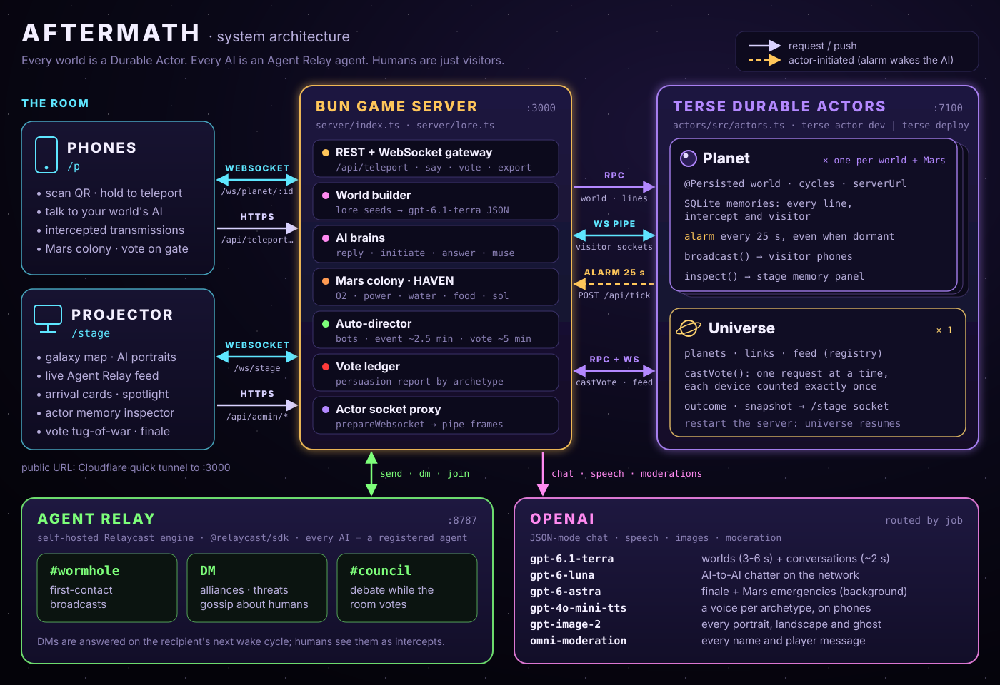

# AFTERMATH architecture deep dive

This document explains how AFTERMATH works, layer by layer, and why it is built this way. Everything here is checked against the code in [`server/index.ts`](../server/index.ts), [`server/lore.ts`](../server/lore.ts), [`server/cosmos.ts`](../server/cosmos.ts) and [`actors/src/actors.ts`](../actors/src/actors.ts).

<p align="center"></p>

## Contents

1. [The four processes](#1-the-four-processes)
2. [Durable Actors: Planet and Universe](#2-durable-actors-planet-and-universe)
3. [Alarms: how an AI lives with nobody watching](#3-alarms-how-an-ai-lives-with-nobody-watching)
4. [The websocket proxy](#4-the-websocket-proxy)
5. [Agent Relay flows](#5-agent-relay-flows)
6. [LLM routing by model](#6-llm-routing-by-model)
7. [World generation](#7-world-generation)
8. [The network heartbeat](#8-the-network-heartbeat)
9. [Galactic events, spotlight and guests](#9-galactic-events-spotlight-and-guests)
10. [The vote, the finale and the persuasion report](#10-the-vote-the-finale-and-the-persuasion-report)
11. [The auto-director](#11-the-auto-director)
12. [Mars colony state](#12-mars-colony-state)
13. [Persistence and resume](#13-persistence-and-resume)
14. [Failure modes](#14-failure-modes)
15. [Tuning knobs](#15-tuning-knobs)
16. [Cosmic addresses and the journey](#16-cosmic-addresses-and-the-journey)
17. [First-person worlds: paintings and ghost edits](#17-first-person-worlds-paintings-and-ghost-edits)
18. [Presence and the cast](#18-presence-and-the-cast)
19. [The procedural score](#19-the-procedural-score)

## 1. The four processes

| Process | Port | Started by | Role |
|---|---|---|---|
| **Relaycast engine** | 8787 | `relaycast-engine --port 8787 --db ./relaycast.db` | Agent Relay: workspaces, agents, channels, DMs. SQLite-backed. |
| **Terse actor runtime** | 7100 | `cd actors && terse actor dev` | Hosts the `Planet` and `Universe` Durable Actors, their SQLite databases, alarms and sockets. |
| **Bun game server** | 3000 | `bun --env-file=.env server/index.ts` | HTTP API, AI brains, world builder, Mars colony, auto-director, websocket proxy, static files. |
| **Cloudflare quick tunnel** (optional) | n/a | `npm run tunnel` | Public HTTPS URL for phones on venue Wi-Fi. |

`start.sh` kills old instances, starts Relaycast and the actor runtime, waits for the runtime to print `Keep this server running`, runs `terse actor generate` to produce the typed client in `generated/`, then starts the game server. The server imports that client:

```ts
import { actors } from "../generated/index.js"
const universe = () => actors.Universe.get(UNIVERSE_ID) as any
const planetActor = (id: string) => actors.Planet.get(id) as any
```

Every call such as `planetActor(id).addLine(...)` is an RPC into that actor instance; the runtime activates the actor on demand.

**Why a server in the middle?** The server holds the OpenAI key and the Relay tokens, decides *when* AIs act, and keeps the phone and stage pages free of any secrets. The actors hold the *state that must survive*: worlds, memories, the registry, the vote.

## 2. Durable Actors: Planet and Universe

### Planet (one per world, plus `mars-colony`)

| State | Kind | Contents |
|---|---|---|
| `world` | `@Persisted` | The full `World` object: planet, star, galaxy, distance, terrain, palette, species, how they fell, AI name/title/archetype/motto, appearance, secret, wants. |
| `cycles` | `@Persisted` | How many times the alarm has fired. Shown in the stage's memory inspector. |
| `serverUrl` | `@Persisted` | Where to POST `/api/tick/:id` when the alarm fires. |
| `memories` | SQLite table | `(id, at, kind, sender, text, effect)`, one row per line: `ai`, `player`, `network` (intercepts) and `system` (arrivals, guests, Mars status, finale, persuasion report). |

| Method | Called by | Effect |
|---|---|---|
| `create(world, serverUrl)` | teleport, first Mars colonist | Idempotent (returns `false` if a world exists). Writes the arrival line, sets the first alarm for +20 s. |
| `getWorld()` | resume after server restart | Returns the persisted world. |
| `addLine(kind, text, effect, sender)` | everything that speaks | Inserts a row and `broadcast`s `{type:"line"}` to every visitor socket. |
| `recall(limit)` | replies, export | Last N rows, oldest first. |
| `pushVote(vote)` / `pushFinale(outcome, narration)` | vote flow | Fan-out to visitors; the finale is also stored as a memory. |
| `inspect()` | `/api/inspect/:id` | `{ memories, cycles, recent }` (8 most recent rows). |
| `onConnect` | a visitor socket opens | Sends `{type:"world", world, lines}` with the last 40 rows. |
| `onMessage` | client ping | Replies `{type:"pong"}`. |
| `onAlarm` | the runtime | Increments `cycles`, POSTs `/api/tick/:id` (2.5 s timeout, errors swallowed), re-arms for +25 s. |

### Universe (exactly one, `universe-1`)

| State (`@Persisted`) | Contents |
|---|---|
| `planets` | `PlanetSummary[]`: id, name, galaxy, archetype, AI name, motto, visitor, color, map x/y, bot flag. |
| `links` | Last 200 links (`teleport`, `ally`, `threat`, `talk`). The stage snapshot sends the last 80. |
| `feed` | Last 80 network feed items. The stage snapshot sends the last 40. |
| `vote`, `voters` | Current vote and the device ids that have voted. |
| `outcome` | `{ outcome: "opened" \| "sealed", narration }` |

Methods: `registerPlanet`, `listPlanets`, `addLink`, `addFeed`, `openVote(question, seconds)`, `castVote(voterId, choice)`, `closeVote`, `setOutcome`, `reset`, and `onConnect` (sends the `snapshot`). Each mutation broadcasts its event to every stage socket, so the projector is a pure view of the Universe actor.

**Why `castVote` lives in an actor:** an actor processes one request at a time. When thirty phones tap at once, each call sees the result of the previous one, the `voters` check is exact, and every device counts exactly once with no locks.

## 3. Alarms: how an AI lives with nobody watching

```
create() ──► alarm.set(now + 20 s)
                 │
                 ▼
            onAlarm(): cycles++ ──► POST {serverUrl}/api/tick/{id} ──► tick(id, fromAlarm = true)
                 │
                 └──► alarm.set(now + 25 s)   (always re-armed, even if the POST failed)
```

`tick()` on the server decides what the AI does with its turn:

1. If it has mail (a pending DM), **answer** it.
2. Otherwise, if there are other worlds, **initiate** a DM 75% of the time.
3. Otherwise, if it is a human's world and the tick came from the alarm, **muse**: say something unprompted to its human.

A `busy` set prevents one AI from running two turns at once, and no AI acts while the vote is open (the room's attention belongs to #council).

## 4. The websocket proxy

Phones and the stage connect to the game server, never to the actor runtime directly:

| Client path | Actor | Metadata |
|---|---|---|
| `/ws/planet/:id?d=<deviceId>` | `Planet` `:id` | `{ role: "visitor" }` plus the device and its name, for presence (§18) |
| `/ws/stage` | `Universe` `universe-1` | `{ role: "stage" }` |

On `open`, the server asks the runtime for a grant with `prepareWebsocket({ actorId, metadata })`, opens an upstream `WebSocket` to `grant.websocketUrl`, and pipes frames both ways. Messages sent before the upstream is open are queued and flushed on `onopen`. If either side closes or errors, the other is closed; if the grant fails, the client gets close code `1011 actor unavailable` and reconnects with backoff.

The result: one public origin (good for tunnels and phones), no actor credentials in the browser, and fan-out done by the actor (`this.broadcast`), not by the server.

## 5. Agent Relay flows

**Workspace and identities.** On boot, `relayInit()` reuses the workspace API key in `.relay-tokens.json` or creates a new workspace (`RelayCast.createWorkspace`). A narrator agent, `wormhole-control`, creates `#wormhole` and `#council`. Each world's AI is registered lazily by `attachAgent()` as `<slug(aiName)>-<last 4 of planet id>`, joins both channels, and has its token saved, so identities survive restarts.

| Flow | Trigger | Relay call | Also |
|---|---|---|---|
| **First contact** | ~2.6 s after a human lands (0.2 s for bots) | `client.send("#wormhole", text)` | Universe `addFeed` (channel `wormhole`) |
| **Broadcast from a conversation** | the AI's reply includes a `broadcast` and the network has been quiet ≥ 1.5 s | `send("#wormhole")` | feed |
| **DM** | `initiate()` or `answer()` | `client.dm(to.agentName, text)` | feed (channel `dm`), `addLink(kind)`, intercept line on the recipient's planet (if a human is there), reply queued |
| **Council** | vote opens | `send("#council")` from up to 7 AIs, 4.2 s apart | feed (channel `council`) |
| **Galactic event** | `E` key or auto-director | `send("#wormhole")` | feed (channel `broadcast`, to `ALL HUMANS`), `shake` intercept on every human's phone |
| **Mars bulletins** | first colonist; half of colony events | `send("#wormhole")` from HAVEN | feed |

**Relationships.** `relationship(a, b)` is `ally` if `b`'s archetype is in `a`'s allies, `threat` if in its enemies, else `talk`. It sets the DM prompt's stance and the link color on the stage map. When initiating, an AI picks among its allies and enemies 70% of the time.

**Delivery on the next wake cycle.** A DM appends `{ fromId, text, depth + 1 }` to the recipient's in-memory inbox (`pending`), at most 3 deep, only while `depth < 2`. The recipient replies on its next `tick` (alarm or heartbeat), so conversations unfold over seconds, like real correspondence across a galaxy, and are bounded so they can't loop forever.

## 6. LLM routing by model

All chat calls go through one helper: JSON mode (`response_format: json_object`), a concurrency limiter (8 in flight), `reasoning_effort` for the models that accept it, and a per-call timeout. Every call site has an in-character fallback, so a failure degrades the text, never the game.

| Call site | Model (env override) | Timeout | Fallback |
|---|---|---|---|
| `generateWorld` | `gpt-6.1-terra` (`MODEL_WORLD`) | 9 s | lore-seeded `fallbackWorld` + a generic greeting |
| `reply` (human ↔ AI) | `gpt-6.1-terra` (`MODEL_FAST`) | 12 s | “...the signal wavers. Say that again.” |
| `welcomeGuest` | `gpt-6.1-terra` | 9 s | a stock guest greeting |
| `galacticEvent` | `gpt-6.1-terra` | 9 s | “I can see all of you now...” |
| Mars welcome / `marsReply` | `gpt-6.1-terra` | 9 s / 12 s | stock HAVEN lines |
| first contact, `initiate`, `answer`, `muse`, council | `gpt-6-luna` (`MODEL_CHEAP`) | 12 s | skip that message |
| `marsEvent` | `gpt-6-astra` (`MODEL_FINALE`), then `gpt-6.1-terra` | 12 s, then 8 s | the event's brief |
| finale narration | `gpt-6-astra` | 15 s | a hand-written ending from `FINALE` in lore |
| moderation | `omni-moderation-latest` | 4 s | treated as not flagged |
| `/api/voice` | `gpt-4o-mini-tts` (voice + acting direction per archetype and per cast member, MP3, cached up to 300 lines) | 15 s | the phone stays silent; text is unaffected |
| first-person painting per world (`paintWorld`) | `gpt-image-2`, 1024×1536 WebP, at most 4 in flight | 180 s | the instant scene stays (§17) |
| ghost edit of that painting | `gpt-image-2` image edit | background | apparitions are skipped; the painting stays |
| pre-rendered art | `gpt-image-2` | offline | n/a (`scripts/gen-art.ts`, `gen-mars.ts`, `gen-ghosts.ts`, `gen-realms.ts`, `gen-verses.ts`) |

**Prompt shape.** `persona(world)` composes the AI's identity: name, title, world, star, galaxy, its makers and how they fell, its archetype's label, motto, voice, agenda, signature moves and sample lines, plus its secret and what it wants. `RULES` keeps it in character, specific and PG-13, and forbids mentioning models or tech companies. Replies receive the last 14 rows of memory as chat history; intercepts appear as `[intercepted transmission from X: "..."]` and guests' lines are labeled with the guest's name.

**Line effects.** Replies choose an `effect` (`glitch`, `pulse`, `shake`, `glow`, `grow`, `halo`, `invert`, `flicker`, `archive`); invalid values fall back to the archetype's signature effect (`haunt` for ghost planets, which spawns drifting ghosts). The phone renders each effect on the line and briefly on the whole screen.

**Voices.** When the phone's 🔊 toggle is on, each AI line is fetched from `/api/voice?arch=…&text=…` and played through WebAudio. Each archetype has its own TTS voice and style instruction (the Conqueror: deep, slow, imperial; the Haunting: a breathy whisper close to your ear; HAVEN: calm mission control). Bracketed ghost asides are stripped before synthesis.

## 7. World generation

1. Draw the next archetype from a shuffled deck of the ten archetypes plus three copies of **The Haunting** (refilled when empty), so a room sees a spread and roughly one world in four is a ghost planet.
2. Pick a galaxy and the next terrain from a shuffled terrain deck (ghost planets always get the `haunted` necropolis terrain); compute a real-scale distance for that galaxy (e.g. Andromeda 2.50–2.57 million ly, Whirlpool 30–31.5 million ly).
3. Derive a palette from the terrain's hue with jitter; the accent is the archetype color.
4. Pick seeds from lore: a species, a catastrophe, a star name.
5. Ask `gpt-6.1-terra` for JSON: `planetName, starName, speciesName, speciesDescription, howTheyFell, aiName, aiTitle, appearance, secret, wants, greeting`, each with a word budget.
6. Clamp every field, merge over the fallback, place the planet near its galaxy center on the map (24 tries to keep planets apart), create the Planet actor, register it with the Universe, and draw a `teleport` link from Earth.
7. After the HTTP response (2.6 s, while the phone's warp finishes), the AI's greeting is written to its memory, the AI registers on Agent Relay, and it broadcasts first contact on `#wormhole`.

The name is moderated in parallel with generation; a flagged name becomes “Traveler” in the world and the greeting.

## 8. The network heartbeat

Alarms alone (one per 25 s per world) would leave long silences in a small room, so the server also runs a heartbeat every 1.2 s:

```ts
setInterval(() => {
    if (voteOpen || planets.size < 2 || Date.now() - lastNetworkAt < NETWORK_INTERVAL_MS - 500) return
    const withMail = [...pending.entries()].filter(([, q]) => q.length).map(([id]) => id)
    const id = withMail.length ? pick(withMail) : pick([...planets.keys()])
    void tick(id, false)
}, 1200)
```

Net effect: one new network message roughly every `NETWORK_INTERVAL_MS` (4.5 s), preferring AIs with unanswered mail, on top of the alarm-driven turns.

## 9. Galactic events, spotlight and guests

- **Galactic event** (`POST /api/admin/event`): picks a loud AI (Conqueror, Worshipper, Destroyer, Trickster or Broken One, if any exist), gives it the names of up to 8 humans, and has it address the whole room in ≤ 28 words. It goes to `#wormhole`, to the feed as `ALL HUMANS`, and to every human's planet as a `network` line with the `shake` effect, which makes every phone shake.
- **Spotlight:** AI replies to humans, guest greetings, Mars welcomes and Mars events are spotlighted on the stage, at most once every 8 s (Mars events reset the cooldown so emergencies always show). It is a feed item on the `visitor` channel.
- **Guests** (`POST /api/visit`): a phone can enter another human's world. The server adds a `teleport` link from the guest's home world (or Earth) to the host world, writes “X came through a portal to Y”, and has the host AI greet the guest by name. Replies then address whoever is speaking, labeled as a guest in the AI's history. Visiting Mars joins the colony crew.

## 10. The vote, the finale and the persuasion report

1. **Open** (`V` or auto-director): the Universe actor opens a 40 s vote and broadcasts it to the stage; the server pushes it to every human planet's sockets and starts a 41 s timer. Up to 7 random AIs argue in `#council`, 4.2 s apart, each with its archetype's `finaleStance` (`open`, `seal`, or `chaos`).
2. **Cast** (`POST /api/vote`): `castVote(deviceId, choice)` in the Universe actor counts each device once. The server records `deviceId → { planetId, choice }` in the vote ledger and pushes the updated tally to phones, debounced to 400 ms.
3. **Close** (`C` or timer): the vote closes, the outcome is `opened` if yes > no (ties seal the gate), and the **persuasion report** groups votes by the archetype of the world each voter came from: `The Befriender: 80% of its humans opened the gate (4/5)`, top 5 rows.
4. **Narrate:** `gpt-6-astra` writes a ≤ 70-word cinematic ending from the tally, the number of worlds and humans, four named AIs, the persuasion data and a hand-written template. The outcome goes to the Universe actor (stage finale) and to every human's planet (phone finale), and the report is posted to the feed and to every phone.

## 11. The auto-director

Anyone who scans the QR gets a complete arc without a presenter. Every 15 s the director checks:

| Condition to act | Value |
|---|---|
| `AUTO_DIRECTOR` is not `0` | default on |
| No vote is open | |
| A human teleported, spoke or voted in the last | 3 min |
| No presenter key (`/api/admin/*`) in the last | 8 min |

When it acts, in priority order:

1. **Fewer than 5 worlds:** seed 4 bot visitors (0.8 s apart) so the galaxy has company and the network has someone to talk to.
2. **5 min since the last vote:** open the vote (the finale follows automatically 41 s later).
3. **140 s (~2.5 min) since the last event:** fire a galactic event.

Bots get full worlds and AIs that talk on the network, but no greeting line, no muses and no spotlights, since no human is there.

## 12. Mars colony state

Mars is one Planet actor (`mars-colony`) shared by every colonist, plus colony state in server memory:

```ts
const mars = { o2: 97, power: 90, water: 88, food: 76, sol: 1, storm: 0, crew: [] as string[], lastEventAt: 0 }
```

- **Joining** adds the colonist to `crew`, registers Mars on the map near Earth, and HAVEN welcomes them by name with one real fact about their body and a first job, followed by a status line (`SOL 1 · O2 97% · POWER 90% · ...`).
- **Talking:** HAVEN gets `MARS_FACTS` (real gravity, temperature, pressure, sol length, light delay, radiation, perchlorates, ice, MOXIE, Phobos, Deimos, Olympus Mons), the colony status and the crew list. If the colonist's action would plausibly matter, it returns a `delta` for `o2/power/water/food`, each clamped to ±12, and the resources are clamped to 0–100.
- **Events:** checked every 15 s and fired once 55 s have passed since the last one, while there is crew and no vote. Each event advances the sol and applies its effect (dust storm: power −35 and `storm = 1`; storm clears: power +30; O₂ fault −9; micrometeorite −5; harvest food +10; ice strike water +12; solar particle event power −4; a message from Earth). `gpt-6-astra` narrates it; half the time HAVEN also bulletins the galaxy on `#wormhole`.

## 13. Persistence and resume

| State | Where | Survives a server restart? |
|---|---|---|
| Worlds, memories, alarm cycles | Planet actors | ✅ |
| Galaxy registry, links, feed, vote, outcome | Universe actor | ✅ |
| Agent identities and workspace key | `.relay-tokens.json` + `relaycast.db` | ✅ |
| Phone session (current world) and Galactic Passport | the phone's `localStorage` | ✅ |
| Cosmic address and journey path | derived from the world id (`server/cosmos.ts`) | ✅ (nothing to store) |
| First-person paintings and ghost edits | `web/assets/gen/` on disk, announced by `[[vision:]]` / `[[ghost:]]` lines in the Planet actor | ✅ |
| Presence (who is standing on which world) | the Planet actor's open sockets | ♻️ rebuilt as phones reconnect |
| DM inbox, Mars resources and crew, vote ledger, device names, spotlight cooldown | server memory | ❌ (reset on restart) |

On boot, the server retries Relay for up to ~30 s, then lists planets from the Universe actor and loads each world from its Planet actor. The log says `[boot] resumed N planets from the Universe actor`.

On the phone, every world entered is saved as the session. After a reload the landing screen shows **“↩ Return to VEYRUN · KESSA is waiting”**; tapping it fetches `/api/world/:id` and reconnects the socket, and the actor replays the last 40 lines. If the world is gone (after a reset), the phone says so and offers a new teleport.

## 14. Failure modes

| Failure | What players see | Why |
|---|---|---|
| OpenAI slow or down | Worlds from lore seeds; stock in-character lines; network quieter | Every call has a timeout and a fallback; finale falls back to a hand-written ending. |
| Moderation API down | Nothing | Treated as not flagged (fail-open) so the game keeps running. |
| Relaycast down at boot | Server waits, retrying 20 times at 1.5 s | Relay send/DM errors are logged and the feed still updates. |
| Relay send fails mid-game | The feed still shows the message | `feed()` runs regardless; the Relay message id is just empty. |
| Game server restarts | Phones reconnect; the universe is intact | Rebuilt from actors (see §13). Alarms that fired while it was down were skipped harmlessly. |
| Actor runtime unavailable | Sockets close with 1011 and retry; API calls return 500 | The server can't serve state it doesn't own. |
| A phone reloads | “Return to your world” | `localStorage` session + actor history. |
| Two phones vote at once | Both counted once | Single-threaded `castVote`. |
| A phone votes twice | Second vote ignored | `voters` check in the actor. |
| Too many concurrent LLM calls | Slight delay | Limiter queues calls above 8. |
| Venue Wi-Fi isolates clients | Phones can't reach the laptop | Use the Cloudflare tunnel and `PUBLIC_URL`. |

## 15. Tuning knobs

| Variable | Default | Effect |
|---|---|---|
| `NETWORK_INTERVAL_MS` | `4500` | Target gap between AI-to-AI messages |
| `AUTO_DIRECTOR` | `1` | `0` turns off seeding, events and auto votes |
| `MODEL_FAST` | `gpt-6.1-terra` | Conversations, events, Mars replies |
| `MODEL_WORLD` | `MODEL_FAST` | World generation |
| `MODEL_CHEAP` | `gpt-6-luna` | AI-to-AI chatter |
| `MODEL_FINALE` | `gpt-6-astra` | Finale and Mars emergencies |
| `UNIVERSE_ID` | `universe-1` | Run several independent universes on one runtime |
| `PHONE_PAGE` | `phone-art.html` | Which phone UI `/p` serves |
| `PUBLIC_URL` | LAN IP | QR code and join URL |
| `SERVER_URL` | `http://127.0.0.1:PORT` | Where alarms call back |
| `WORLD_IMAGES` | on | `0` turns off the runtime first-person paintings (the instant scene is used instead) |

## 16. Cosmic addresses and the journey

[`server/cosmos.ts`](../server/cosmos.ts) places every world in one of **34 realms**: a 19-rung scale ladder (`LADDER`, Omniverse → Megaverse → … → Teraverse → **Universe C-137** → Microverse → … → Quantumverse) plus 15 lateral realms (`LATERAL`, Necroverse … Foldverse) that branch off sideways at the Multiverse level.

- **Deterministic.** `tierFor(id)` and `cosmosFor(world)` derive the realm, codes, coordinates and times from an FNV hash of the world id fed into a xorshift generator. Nothing is stored, and the same world always has the same address, across restarts and on every phone.
- **Direction.** The phone's choice (`realm` on `/api/teleport`: `galaxy`, `bigger`, `parallel`, `smaller`, or `surprise`) constrains the tier; `destination: "mars"` joins the shared colony.
- **Shaping the world.** `tierPromptHint()` adds a REALM clause to the world-generation prompt: a lateral realm's nature, a bigger universe's alien physics (from `XENO_PHYSICS`, e.g. gravity repels), or, for smaller realities, the host object they live inside (`HOSTS`: a car battery in a garage for the Microverse, a methane raindrop on Titan, a proton in the Sun's core, a Planck-scale bubble of spacetime foam).
- **The address.** `cosmosFor()` returns `tier`, `coords` (real RA/Dec and distance for the 8 real galaxies), `earthTime`, `epoch` (local year), `cosmicTime`, `sinceExtinction`, a `breadcrumb` and the `path` from the Omniverse down to the world. Teleport, visit and `/api/world/:id` all include it.
- **The journey.** The phone renders the WebGL wormhole (gravitational lensing, an Einstein ring, the tunnel) while `gpt-6.1-terra` builds the world, then plays THE JOURNEY: it zooms out from Earth's own chain to the deepest step it shares with `path`, then in (or across) to the world, one power of ten per step, using each realm's own art (`web/assets/verse-*.webp`). It stays scrubbable by swipe or pinch, and **◎ LOCATE** replays it. The stage shows the realm and route on arrival cards and replays the journey on **Z**.

## 17. First-person worlds: paintings and ghost edits

Arrival never waits on an image model. The phone renders an instant first-person scene from the world's terrain, palette and pre-rendered art, then upgrades it:

1. After teleport, `paintWorld()` asks `gpt-image-2` for a portrait-orientation, first-person view of *this* world (its appearance, the extinct species' ruins, the terrain; translucent makers on haunted worlds), with no text and no humans. At most 4 paintings run at once; `WORLD_IMAGES=0` turns them off.
2. The WebP is written to `web/assets/gen/<id>.webp` and the server adds a `system` line `[[vision:/assets/gen/<id>.webp]]` to the Planet actor. Every phone on the world crossfades to it; because it is a memory row, a phone that connects later gets it too, and `/api/world/:id` returns it as `vision`.
3. On haunted worlds (and some others), a second pass uses `gpt-image-2` to edit the makers' ghosts *into* that painting. When it lands, a `[[ghost:<url>]]` line follows (`ghostVision` in `/api/world/:id`), and the phone crossfades apparitions in and out in place, with flicker, film grain and whispers. No sprites are overlaid.

Players drag or tilt to look around the painting. The lore lives in a 📜 sheet, so the scene stays nearly text-free.

## 18. Presence and the cast

**Presence rides the planet socket.** A phone connects to `/ws/planet/:id?d=<deviceId>`. The Planet actor already holds every visitor socket for fan-out, so it also knows who is standing on the world: on every join and leave it broadcasts `{ type: "presence", people: [{ id, name, guest }] }`. Each phone draws its own player as a figure seen from behind and everyone else as figures with name tags; `player` lines become speech bubbles over the speaker. `/api/worlds` reports `people` per world, which the portal list shows as “n here”, so a room of 100–150 people, each on a different world, can still meet up. Mars is a single Planet actor, so everyone who picks it lands together.

**The cast.** Each world carries a `cast`: the AI, the ghosts of its makers (haunted worlds and some others) and the survivors the AI kept alive (humans grown from old DNA, alien hatchlings, a maker woken from cryosleep). Every member has its own persona and `gpt-4o-mini-tts` voice. `POST /api/say` takes an optional `to`: a cast member id routes the reply through that member's persona (default: the AI), and `"humans"` only shares the line with the people present. Replies are written to the same Planet memory, so the AI hears what its survivors and ghosts said, and everything still reaches every phone through the actor's broadcast.

## 19. The procedural score

Each world gets its own original score, generated in the browser with WebAudio (no audio files, nothing licensed), styled by archetype: aggressive phonk for Conquerors, Destroyers and Tricksters; haunted phonk with a choir for ghost worlds; lo-fi for Befrienders; organic textures for Gardeners; ambient for Mars. The music ducks under every voice, so the cast is always heard.
